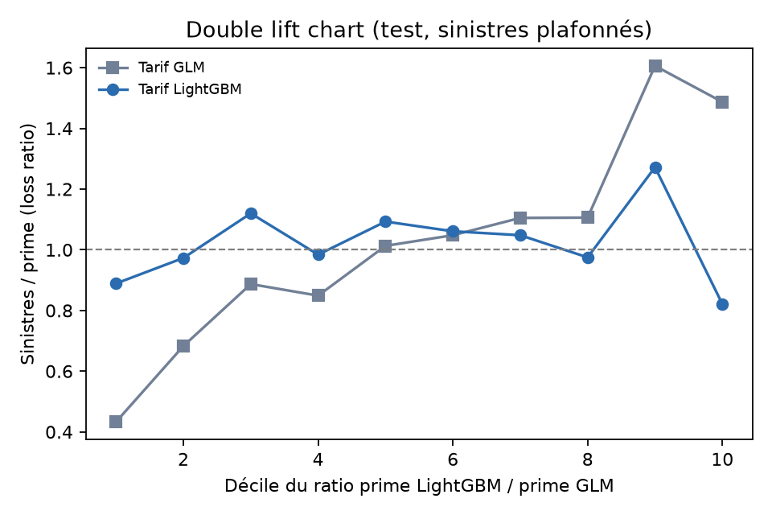
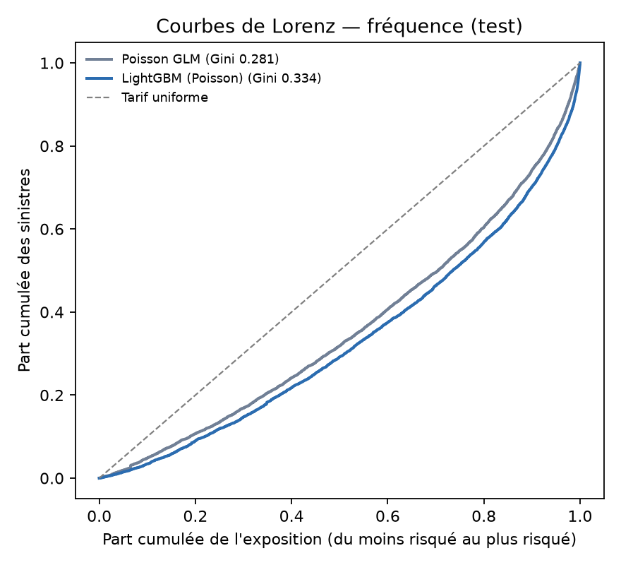
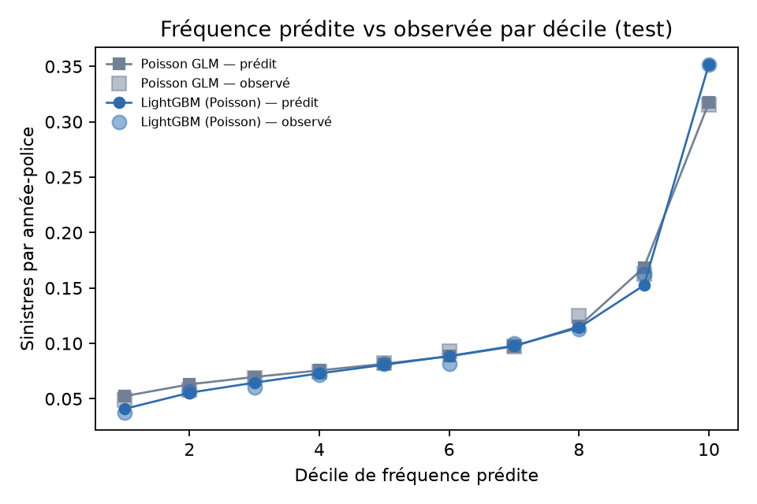
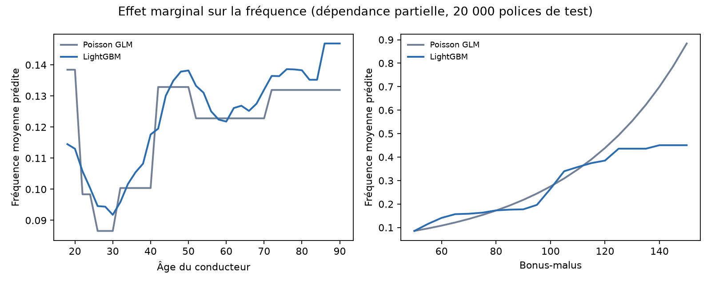

# Claims Pricing Lab: frequency × severity motor tariff, GLM vs gradient boosting

A motor-insurance pricing study on **678,013 French third-party liability policies** (freMTPL2). It builds the actuarial standard, **Poisson × Gamma GLMs** with a relativity table, compares it with **gradient boosting** using Poisson and Gamma objectives, and turns both into a balanced pure-premium tariff.

The evaluation uses the tools pricing actuaries use: Poisson deviance, Lorenz-curve Gini, calibration by decile, and a **double lift chart**.

Every number below comes from code in this repo (`python run_all.py`). The test set was scored once.

> **Résumé (FR)** — Tarification automobile (responsabilité civile) sur 678 013 polices françaises : modèles fréquence × coût, GLM Poisson/Gamma (standard actuariel, table de relativités) contre gradient boosting (LightGBM). Le découpage par groupe de profils de risque évite les fuites de données, les sinistres graves sont plafonnés et donnent lieu à un chargement, la prime pure est équilibrée sur l'apprentissage, et la comparaison des tarifs se fait par Gini de Lorenz et double lift chart.



## Headline results (test set: 136,072 policies, 71,621 policy-years)

| Claim frequency | Poisson deviance (×100) ↓ | Lorenz Gini ↑ | Predicted / actual claims |
|---|---|---|---|
| Portfolio average | 62.57 | 0 | 7,208 / 7,174 |
| Poisson GLM (actuarial binning) | 59.52 | 0.281 | 7,202 / 7,174 |
| **LightGBM, Poisson objective** | **57.61** | **0.334** | 7,220 / 7,174 |

- **Frequency:** LightGBM lowers the Poisson deviance by **1.91** (×100), with a paired bootstrap 95% CI of [−2.10, −1.73]. Both models predict the portfolio's total claim count within 0.7%.
- **Tariff (pure premium):** both tariffs are balanced on attritional claims, with a test loss ratio of **1.01**.
  - The LightGBM tariff ranks risk better: Gini on capped claim cost is **0.284 vs 0.227**, a gain of **+0.057 [+0.041, +0.077]**.
  - **Double lift chart:** where the two tariffs disagree, the GLM's loss ratio swings from **0.43 to 1.61** (over-charging some risks, under-charging others). LightGBM's stays between **0.82 and 1.27**.

<p float="left">
  
  
</p>

## What the models learned


- **Bonus-malus:** the GLM's log-linear form keeps growing exponentially, predicting **0.88 claims/year** at bonus-malus 150. LightGBM levels off at about **0.45**, which is where the GLM over-prices bad-history drivers.
- **Driver age:** the GLM steps between age bands; LightGBM learns a finer, non-monotonic curve: lowest around age 30, a rise into the late 40s, and higher again for older drivers. For drivers aged 18–20 it predicts 0.115 claims/year vs the GLM's 0.138.
- **Relativity table:** the GLM produces the format actuaries price with. It's in [`reports/glm_frequency_relativities.csv`](reports/glm_frequency_relativities.csv), with one multiplicative factor per risk-factor level and a 95% CI.

## Severity: an honest negative result
| Average claim (capped) | Validation Gamma deviance | Test Gamma deviance |
|---|---|---|
| Portfolio average | 1.110 | **1.148** |
| Gamma GLM | 1.096 | 1.157 |
| LightGBM (Gamma) | **1.090** (selected) | 1.155 |

LightGBM was selected because it was best on validation, but **on test neither model beats the average claim**. In this data, claim cost is barely explained by the rating factors. That matches the reference study, and the tariff's ranking power therefore comes almost entirely from frequency. Reporting this, rather than tuning on the test set until severity "works", is deliberate.

## Large claims
- **Concentration:** claims above **€34,387** (the 99.5th percentile) are 0.5% of claims but **25.3% of total cost**. Individual claims reach €4.08M.
- **Approach:** they're capped for modelling, and the excess comes back as a **large-claim loading** (×1.257, estimated on train).
- **What happened on test:** the excess share of cost was **39.4%** instead of about 20%, because a handful of very large claims fell in the test set. The total loss ratio including the loading is therefore 1.32, while the attritional loss ratio is 1.01.
- **Takeaway:** large losses are volatile and need their own treatment (excess-of-loss reinsurance, large-loss models), not a frequency × severity GLM.

## Method
- **Data:** freMTPL2freq + freMTPL2sev ([OpenML 41214](https://www.openml.org/d/41214) / [41215](https://www.openml.org/d/41215)). There are 36,056 claims and 26,639 recorded amounts; 9,116 policies have claims without a recorded amount (a known inconsistency).
- **Cleaning,** following Noll, Salzmann & Wüthrich (2018), *Case Study: French Motor Third-Party Liability Claims* (SSRN 3164764):
  - claim counts capped at 4;
  - exposure capped at 1 year;
  - GLM features: vehicle power as categories (capped at 9), binned vehicle and driver age, bonus-malus capped at 150, log density, area as an ordinal score.
- **Leakage-safe split:** many rows share all risk factors and likely belong to the same policyholder (Wüthrich & Merz 2023, *Statistical Foundations of Actuarial Learning*). The 70/10/20 train/valid/test split is therefore made **by group**, with 0 groups shared between train and test.
- **Frequency models:**
  - **GLM:** Poisson, log link, offset log(exposure), fitted with statsmodels (49 parameters).
  - **LightGBM:** Poisson objective with log(exposure) as the initial score, and a monotonic constraint on bonus-malus. A small grid is searched on validation with early stopping; the best has 63 leaves, min 1,000 rows per leaf, and 320 trees.
- **Severity models:** average capped claim per policy, weighted by claim count, with a Gamma GLM (log link) and LightGBM (Gamma). The model is selected on validation.
- **Pricing:**
  - attritional pure premium = frequency × severity, multiplied by a balance factor fitted on train (total premium = total capped claims);
  - plus the large-claim loading;
  - compared using Lorenz Gini (Frees, Meyers & Cummings 2011) and a double lift chart.

## Run it
```bash
pip install -r requirements.txt
python run_all.py      # data → frequency → severity → pricing → figures
```

## Limitations
- **Portfolio:** a single French MTPL portfolio from one period; the split is random by group, not out-of-time.
- **Deviance comparisons:** deviance levels aren't directly comparable with the reference paper, which uses a different split and deviance normalisation. Comparisons are made within this repo.
- **Regulatory review:** a production tariff would also need checks such as consistency with discrimination rules and smoothing of relativities, which are not done here.

*Author: Ala-Eddine Riahi, final-year ICT engineering student at ESPRIT. Companion project: [credit-scoring-lab](https://github.com/alaeddineriahi/credit-scoring-lab).*
